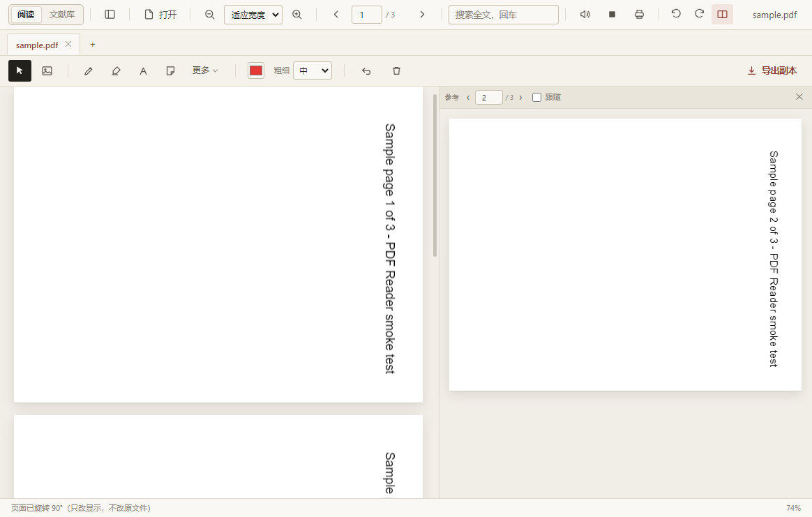

# Trove

本地优先的文档管理器与阅读器，把文献、阅读位置、标注和笔记放进同一个库。支持 Windows 10/11，无需账号；元数据抓取、PDF 下载和网页快照是按需联网操作。


当前应用版本为 **1.4.0**（2026-10-27）。

## 开始使用

已有安装包可直接运行便携版或使用安装版。构建文件位于 `build/`，不随源码提交；请核对其构建时间和对应提交。

从源码运行需要 Node.js 18+、npm 和 Windows：

```powershell
npm ci --no-audit --no-fund
npm run copy-pdfjs
Remove-Item Env:\ELECTRON_RUN_AS_NODE -ErrorAction SilentlyContinue
npm start
```

首次克隆必须执行 `copy-pdfjs`，生成的 PDF.js 文件不受 Git 跟踪。安装与打包排错见[开发文档](docs/development.md)。

## 文献库

- 管理 37 类题录，编辑结构化作者、年份、DOI、URL、摘要及类型专属字段。
- 用标签、嵌套收藏集、智能收藏集整理条目，支持多选、批量编辑、回收站、查重合并和相关条目。工具栏「统计」可查看类型 / 年份 / 标签分布、附件与笔记覆盖率（本地现算，回收站条目不计入），以及阅读时长（打开文档且窗口可见时每 15 秒记一次，12 周热力图；数据在本机，可整文件删除）。
- 收藏集支持 `Ctrl` / `Cmd` + 点击多选，按并集显示条目（同一篇在多个集合里只出现一次）；普通点击仍只选一个，取消最后一个回到「全部条目」。
- 导入与导出 BibTeX、RIS、CSL-JSON、EndNote 标签式 `.enw`、EndNote XML（含 UTF-16 导出）、RefWorks tagged。
- 按 DOI/arXiv 抓取元数据，为条目单独或批量下载可获取的 PDF。下载后进入索引队列；批量任务可取消，当前条目处理完成后生效。
- RSS 订阅：工具栏「订阅」可添加期刊 / arXiv 的 RSS / Atom 源，按需拉取新文章并把感兴趣的收进文献库（webpage 条目）；订阅跟随文献库备份。
- 保存网页为本地 MHTML 和首屏 PNG；MHTML 通过外部程序打开。
- 按条目信息重命名附件，标注和索引跟随应用内改名；文件在外部移动后可重新定位附件。
- 库级写操作支持最多 20 步撤销/重做，连续笔记编辑不占用这套操作栈。删除条目、收藏集或清空回收站不会删除原始文档。

多个收藏集并集（`Ctrl` / `Cmd` + 点击收藏集，右侧按并集去重显示）：


大库列表按视口挂载行，选择状态按条目 key 保存。检索与数据读写仍使用本地 JSON。

## 阅读与标注

PDF 使用 PDF.js，保留文本层；其它格式转换为可阅读的 HTML。支持连续滚动、单页翻页、双页对开（`Ctrl+Shift+D`，偶数页在左、奇数页在右，封面独占）、目录、缩略图、文内搜索、缩放、深色页面反色与专注阅读。


- 多标签阅读，各文档记住页码、视图旋转角与参考页；读过的 PDF 在文献列表显示进度条，详情面板可「继续阅读」直接回到上次位置。设置中开启会话恢复后，下次启动恢复最多 20 个标签及激活项；失联文件跳过并提示。
- 整篇文档可旋转 90° / 180° / 270°（工具栏按钮或 `Ctrl+[` / `Ctrl+]`）。旋转只改显示：原文件、打印和带标注副本仍按原方向输出；标注、选区与搜索高亮继续按未旋转页面坐标保存。
- 分屏参考视图在右侧独立显示同一 PDF 的另一页，只读、不带标注，可单独翻页或勾选「跟随」对照正文下一页。参考页随视图旋转，并随标签 / 会话恢复。
- 导航历史记录目录、搜索、批注和显式跳页，可后退/前进；历史按标签隔离，最多 60 个位置。按 `B` 给当前页加 / 删书签，书签列在侧栏「目录」页顶部，点击跳页。
- **智能跳转**：PDF 里点引用标记（`[12]` / `[Smith, 2020]`，不需要文档自带链接）跳到参考文献条目并高亮；点参考文献条目行反查正文引用标记。只识别常见的数字型与作者-年份型，识别错误时不会跳转。
- 画笔、荧光笔、直线、矩形、箭头、文字、便签、文字高亮、下划线、摘录与图片标注。
- PDF 自带标准批注可导入本地标注层，保留支持类型的文字、评论、作者与颜色，按原生 ID 去重；回复关系（/IRT）记录为「↳ 回复」标记显示在批注面板与标注库。扫描时切换文档会取消导入。
- 文献库“标注”视图汇总各文档批注，支持文字搜索、标签、类型与颜色筛选，以及生成带截图笔记。
- 支持查看 PDF 内嵌位图、调用系统默认程序打印。扫描件没有文字层，朗读会跳过该页；整篇都是扫描页时提示没有可读正文。
- 朗读按句连续进行：读完当前页自动接下一页，空白页跳过；当前句在页面上高亮并自动滚动到可见位置。支持暂停 / 继续，并按文档记住上次读到的页码与句序，下次打开同一文件从该句续读；朗读中按 `H` / `U` 可直接给当前句加高亮 / 下划线。
- 可导出批注 MD/CSV/TXT 或带标注的 PDF 副本；带标注副本只支持 PDF。

页面旋转 90° 后配合分屏参考视图（右侧为同一 PDF 的第 2 页）：



朗读时的句级高亮与跨页进度：


### 支持格式

| 类别 | 格式与主要边界 |
| --- | --- |
| PDF | PDF.js 渲染、文字层、搜索、标注与副本导出 |
| Word | `.docx`、`.doc`、`.rtf`、`.odt`；旧 `.doc` 主要提取文字 |
| 演示文稿 | `.pptx`、`.odp`；旧 `.ppt` 需先转换 |
| 表格 | `.xlsx`、`.xls`、`.ods`、`.csv`；每表最多 2000 行 × 80 列 |
| 网页与 Markdown | `.html`、`.htm`、`.md`、`.markdown` |
| 电子书 | `.epub`，按章节阅读 |
| 图片 | PNG、JPG、GIF、WebP、BMP、SVG、AVIF 等 |
| 文本与代码 | TXT、JSON、XML、JS、TS、Python 等 |

富文档保留常见文字、列表、表格与图片，不还原复杂分栏、文本框定位、动画或图表。转换最多 400 页、总 HTML 12 MB、单张图片 8 MB，超限可能截断。

## 笔记与内容复用

文献可挂多条子笔记，也可创建独立笔记。独立笔记使用全屏 Markdown 源码/预览编辑器，子笔记在详情面板编辑富文本。独立笔记正文可写 `[[笔记标题]]` 互链，预览末尾会列出提到本条的反向链接。

- 内置课程笔记、论文卡片、摘录汇总模板；已有正文时追加到末尾，保留原选区内容。
- 两类笔记均可导出 HTML 或 Markdown。导出先确认保存成功，失败时保留编辑内容并取消导出。
- 正文图片与批注截图复制到导出文件旁的 `.files/` 目录，改写为相对引用。**分享或移动时要连同图片目录一起携带**，HTML 并未把这些图片嵌入单个文件。
- HTML 对缺失的本地图片显示占位说明；Markdown 保留缺失引用，界面提示缺失数量。
- 支持旧 Markdown 子笔记和富文本笔记的来源链接转换；导出链接保留查询参数，非法协议不会变成可点链接。

自定义引用卡、提示框、任务列表等语法用于笔记预览；数学公式 `$…$` / `$$…$$` 由本地 KaTeX 渲染（需先执行 `npm run copy-pdfjs`，资源缺失时按源码显示）。导出 HTML 携带公式排版与字体；富文本子笔记内公式仍按源码显示。

## 搜索与引用

库级搜索合并正文、批注、摘录和笔记，显示来源、页码与片段，可按结果类型切换。首屏显示 20 条，展开后按页获取更多；主进程默认每页 120 条。

统一语法支持短语、排除、字段限定、AND、OR/`|` 与括号，例如：

```text
"machine learning" -survey
author:Smith year:2024
title:阅读 OR tag:课程
```

搜索框旁的「条件」按钮提供可视化构建器：选字段、勾排除、多条件 AND；打开时会把当前查询反向解析回填（OR / 括号等复杂语法请在搜索框直接输入）。

全文搜索是子串匹配与相关性评分，不做分词、OCR 或语义检索。首次导入后需等待索引完成，也可在设置中重建。

引用提供 5 种内置格式与 3 种内置 CSL 样式，可导入/删除自定义 `.csl`。参考文献表支持 Markdown、文本、HTML、Word `.doc` 和 RTF；`.doc` 是带格式的 HTML。CSL 是自研子集，导入成功不代表符合完整 CSL 或期刊逐字排版要求。详情面板「文内引注…」可生成带页码定位符的正文引注（编号制 `[n, p. 5]` / 作者-年份制 `(Smith, 2024, p. 5)`）。

## 数据、备份与迁移

默认 `userData` 和数据目录为 `%APPDATA%\trove`。数据目录可在设置中更换；部分应用状态仍固定保存在 userData。

| 数据 | 位置 |
| --- | --- |
| 文献库 | `<数据目录>/library.json`，数据层版本 v8 |
| 标注 | `<userData>/annotations/<路径哈希>.json` |
| 图片、网页快照 | `<数据目录>/snapshots/` |
| 托管 PDF、CSL | `<数据目录>/attachments/`、`styles/` |
| 全文索引、备份 | `<数据目录>/fulltext/`、`backups/` |
| 设置、窗口、会话 | `<userData>/settings.json`、`window-state.json`、`session.json` |

JSON 备份包含库、标注、设置和受管图片/快照/CSL/附件；**不含外部引用的原始文档与全文索引**。托管资源总量上限为 60 MB，超限报错。完整归档应同时保留原始文档、数据目录及 userData。

存储位置支持移动、合并、切换已有库。移动复制后保留旧目录；合并时同 key 保留目标条目。资源冲突避让并改写引用，写入失败尝试回滚，成功后才切换目录。恢复前自动生成快照。具体数据约定见[架构文档](docs/architecture.md)。

## 常用快捷键

| 操作 | 快捷键 |
| --- | --- |
| 打开 / 文内搜索 | `Ctrl+O` / `Ctrl+F` |
| 缩放 / 适应宽度 | `Ctrl+滚轮` / `Ctrl+0` |
| 放大模式 | `Z`，滚轮缩放；空格 + 左键拖动平移；`Z` 或 `Esc` 退出 |
| 翻页 | 方向键、PgUp/PgDn、空格 |
| 阅读历史 | `Alt+←` / `Alt+→`，或鼠标侧键 |
| 搜索上一项 / 下一项 | `Shift+F3` / `F3` |
| 朗读中标注当前句 | `H` 高亮 / `U` 下划线 |
| 旋转页面（逆 / 顺） | `Ctrl+[` / `Ctrl+]` |
| 双页对开 | `Ctrl+Shift+D` |
| 当前页加 / 删书签 | `B` |
| 专注模式 / 打印 | `F11` / `Ctrl+P` |
| PDF 副本导出 | `Ctrl+S` |
| 库操作撤销 / 重做 | `Ctrl+Z` / `Ctrl+Y` 或 `Ctrl+Shift+Z` |
| 独立笔记保存 / 返回 | 编辑器内 `Ctrl+S` / `Esc` |

工具栏、页面右键菜单、文献库设置提供其它入口。编辑器聚焦时部分快捷键用于文字编辑。

## 当前边界

- 中文、日文等文字标注仍可能因 PDF 导出字体 Helvetica 无法编码而被跳过；界面显示遗漏数量，需核对副本。
- 页面旋转与分屏只对 PDF 生效，且是视图能力：打印、带标注副本导出仍按原文件方向，页面 PNG 导出按当前旋转方向；分屏为只读位图，不参与标注与文本选择。
- 朗读依赖系统语音；句级高亮与句序记忆只对 PDF 生效，富文档（Word / PPT / Markdown 等）可以跨页连续朗读但没有句级高亮。位置记忆存在本机 `localStorage`，不写入文献库。
- 原生 PDF 批注导入只处理支持的标准对象；扁平化批注无法恢复，部分形状跳过；回复关系只记录标记，不重排嵌套树。
- 无云同步、群组库、浏览器连接器或 Word 自动引注插件；订阅只在点「添加 / 看条目 / 刷新」时联网，不后台轮询、不推送。
- 复杂富文本经 HTML/Markdown 转换可能简化，不能承诺所有粘贴排版无损往返。
- 搜索仍在主进程处理；大库后台查询与增量 IPC 尚未完成。
- 原始文档在资源管理器中改名后，标注不会自动跟随路径，需重新定位。
- 当前以 Windows 验证为主，macOS/Linux 未完成打包验收。

## 开发与验证

- [架构与数据约定](docs/architecture.md)
- [测试、打包与维护](docs/development.md)
- [本轮验收记录](docs/verification-2026-10-26-multi-collection.md)
- [竞品调研与功能规划](docs/竞品调研-2026-10-26.md)
- [开发日记](docs/开发日记.md)
- [变更记录](CHANGELOG.md)

源码回归、当前构建冒烟和人工视觉检查分别记录；旧安装包通过测试不能证明它包含未发布修复。

## 许可

MIT，见 [LICENSE](LICENSE)。
