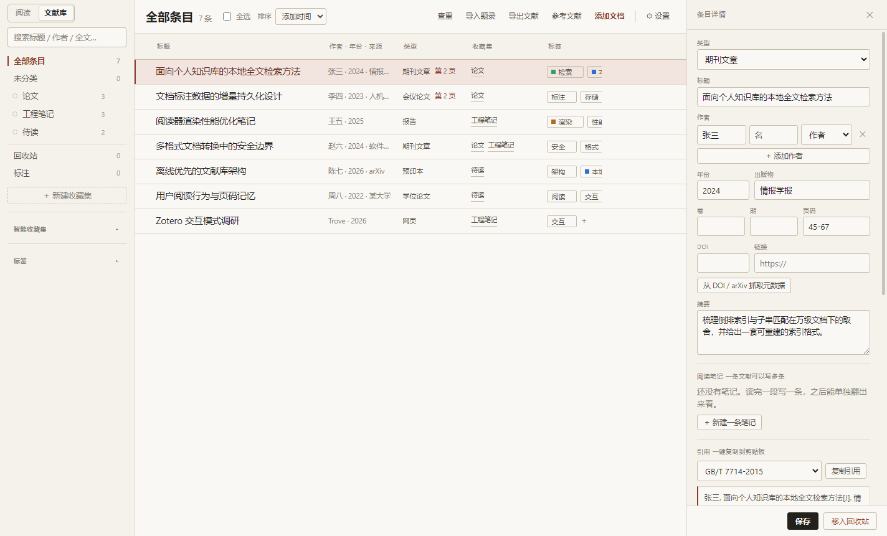
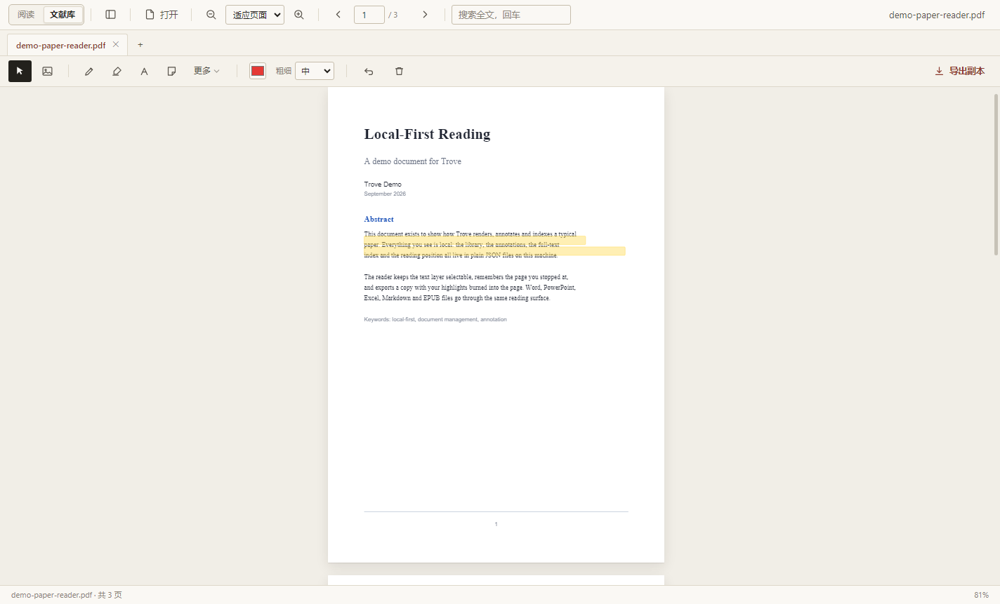
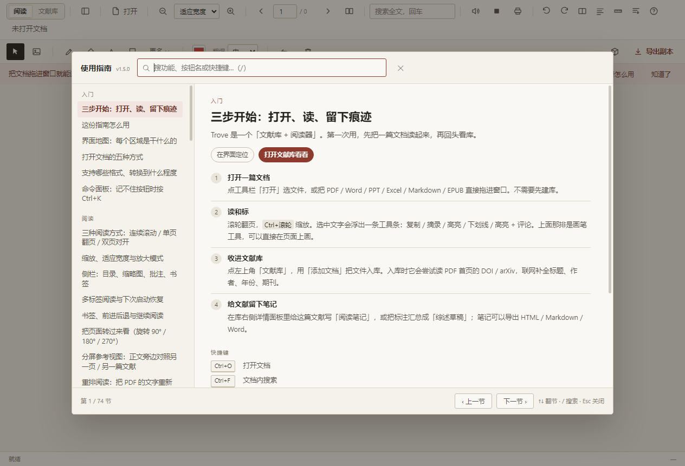

# Trove

**放在自己电脑上的文献库 + 阅读器。** 用来长期读 PDF、做标注、写笔记、整理文献和生成引用。不需要账号，不强制联网；联网只在你主动点“抓取题录 / 下载全文 / 刷新订阅”时发生。



**当前版本 1.7.1**（2026-11-17）。更新记录见 [CHANGELOG.md](CHANGELOG.md)。

## 快速开始

1. **装上并打开**：用安装包或便携版启动，无需登录。
2. **加文献**：点「添加 ▾」选 PDF / 文件夹，或直接把文件拖进窗口。Trove 会读 PDF 首页找 DOI，能联网时自动补全题录；补不到就先用文件名入库。
3. **读文献**：双击条目打开。PDF 保留文字层，可选中、搜索、朗读；其它常见文档会转成可读页面。
4. **做标注**：在上方工具条选高亮、画笔、直线、矩形、文字、便签等，直接在页面上画；选中文字后也可右键操作。标注按页保存，关掉再开还在。
5. **找东西**：文献库有搜索和筛选；打开文档后 `Ctrl+F` 在文内找；`Ctrl+K` 打开命令面板，输命令名就能执行。
6. **拿出去用**：`Ctrl+S` 导出带标注的 PDF 副本；笔记可导出 Word / HTML / Markdown；文献记录可导出 BibTeX、RIS 等格式。

不知道按钮在哪就按 `F1`。软件内置使用指南，从“打开第一份文档”到“导出参考文献”都有分步说明，还能搜。



## 文献库怎么用

- 左侧是列表和收藏集，右侧是选中条目的详情。点条目展开后能改标题、作者、年份、DOI、摘要等。
- 用标签、收藏集整理；选中多条可批量改字段或加标签。收藏集按住 `Ctrl` 点击可多选，按并集显示。
- 「更多 ▾」里有查重、库统计、阅读队列、间隔回顾、RSS 订阅、综述草稿等。
- 附件改名或移动后，打开条目时会按文件指纹自动找回；找不到可在详情面板点「扫描文件夹找回…」。
- 库级写操作支持 `Ctrl+Z` 撤销 / `Ctrl+Y` 重做；删除条目不会删掉原始文件。

## 阅读器怎么用

- 顶栏三个小按钮切换排列：连续滚动 / 单页 / 双页对开；当前项一直高亮。
- 侧栏可切目录、缩略图和批注列表；`B` 给当前页加书签。
- `Ctrl+滚轮` 缩放，`Z` 进入放大模式（滚轮缩放、空格 + 左键拖动平移，`Z` / `Esc` 退出），`Ctrl+0` 回到适应宽度。
- `Alt+←` / `Alt+→` 回到之前的阅读位置；鼠标侧键也能用。
- 读到还没入库的文档，点顶栏「导入文献库」即可建条目。
- 点 PDF 里的 `[12]` 或 `[Smith, 2020]` 可跳到参考文献（智能跳转）；右栏可打开另一篇做对照。
- 朗读按句高亮并自动翻页；`H` / `U` 可直接高亮 / 下划线当前句。
- 旋转、重排、阅读标尺、专注模式等低频功能在 `Ctrl+K` 命令面板和页面右键菜单里。

更多操作看图：



## 设置

在文献库右上点 **⚙ 设置**，改完点「保存设置」。分四页：

| 设置页 | 主要管什么 |
| --- | --- |
| 阅读与外观 | 浅色 / 深色主题、列表默认排序、阅读方式（连续 / 单页 / 双页）、下次启动恢复标签、深色反色、笔记标题样式 |
| 文献与引用 | 引用键 `[@key]` 的模板，可用预设一键套用 |
| 数据与备份 | 数据目录、启动自动建全文索引、备份 / 恢复、全文索引补建 / 重建 / 清空 |
| 高级 | Unpaywall 联系邮箱、机构代理、OpenURL 解析器、设为默认 PDF 阅读器、开发者工具 |

仪器代理、OpenURL 这些是可选的；不用学校代理就留空。

## 数据放在哪

默认在 `%APPDATA%\trove`。设置里「数据与备份 → 更改位置…」可以换目录，Trove 会把数据一起搬过去。

| 内容 | 位置 |
| --- | --- |
| 设置、窗口状态、会话 | `%APPDATA%\trove\settings.json`、`window-state.json`、`session.json` |
| 文献库 | 数据目录里的 `library.json` |
| 标注 | `%APPDATA%\trove\annotations\` 下按文件路径哈希命名的 JSON |
| 图片 / 网页快照 / 附带的 PDF | 数据目录里的 `snapshots\`、`attachments\` |
| 全文索引 / 备份 | 数据目录里的 `fulltext\`、`backups\` |
| 阅读回顾进度 | `%APPDATA%\trove\recall.json` |

在「数据与备份」点「备份文献库…」会导出一个 JSON，包含文献库、标注、回顾、设置和托管资源；**不包含原始 PDF 和全文索引**。要完整归档，把原始文档和数据目录也一起留好。

## 快捷键

| 操作 | 快捷键 |
| --- | --- |
| 打开 / 文内搜索 / 命令面板 / 帮助 | `Ctrl+O` / `Ctrl+F` / `Ctrl+K` / `F1` |
| 缩放 / 适应宽度 / 放大模式 | `Ctrl+滚轮` / `Ctrl+0` / `Z` |
| 翻页 / 回到上个位置 | 方向键、空格 / `Alt+←`、`Alt+→` |
| 当前页加书签 / 双页对开 / 旋转 | `B` / `Ctrl+Shift+D` / `Ctrl+[`、`Ctrl+]` |
| 导出带标注副本 / 打印 / 专注模式 | `Ctrl+S` / `Ctrl+P` / `F11` |
| 撤销 / 重做（库操作） | `Ctrl+Z` / `Ctrl+Y` |

编辑器聚焦时，部分键用于文字编辑。其余入口看工具栏悬停提示和右键菜单。

## 从源码运行

需要 Windows + Node.js 18+：

```powershell
npm ci --no-audit --no-fund
npm run copy-pdfjs
Remove-Item Env:\ELECTRON_RUN_AS_NODE -ErrorAction SilentlyContinue
npm start
```

首次克隆必须执行 `npm run copy-pdfjs`；PDF.js 资源不随 Git 提交。安装与打包排错见 [开发文档](docs/development.md)，架构约定见 [架构文档](docs/architecture.md)。

## 许可

MIT，见 [LICENSE](LICENSE)。
