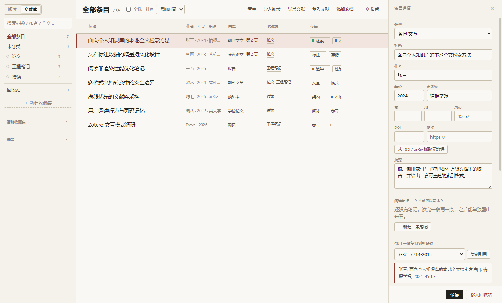
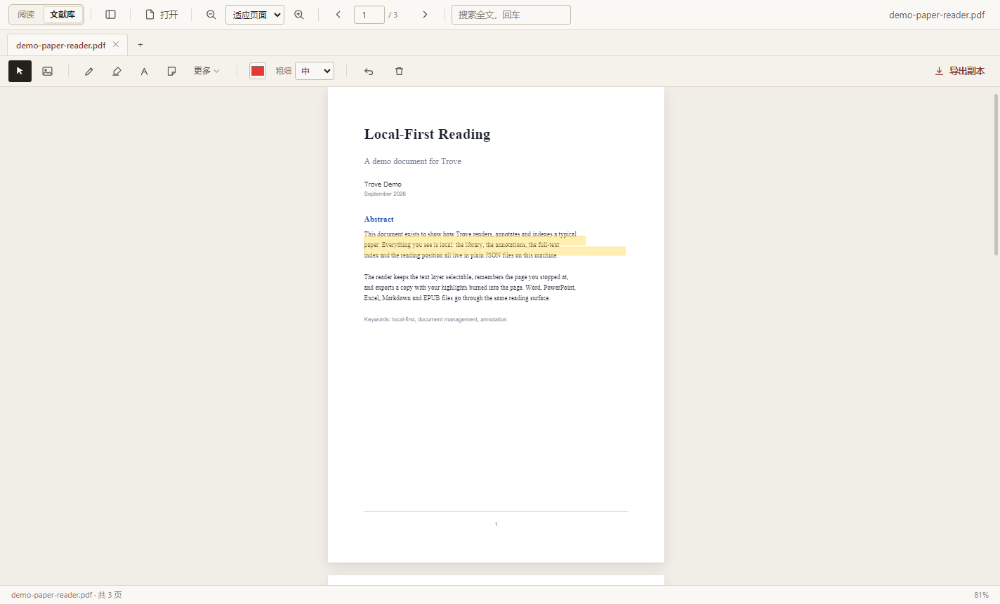

# Trove

**把文档收进一个库，然后一篇一篇读完。** Trove 是一个本地优先的文档管理器兼阅读器：PDF、Word、PPT、Excel、Markdown、EPUB 都能进同一个文献库，标签、收藏集、全文检索、逐页标注共用一套数据。没有账号，没有云同步，所有东西都在你自己的磁盘上。



> 名字取自 a trove——一批被收起来、值得留下的东西。

---

## 它是什么

一个自用的桌面软件，解决三件事：

1. **找得到**——文件散在十几个文件夹里时，用标题、作者、标签、收藏集或全文搜索把它翻出来。
2. **读得下去**——连续滚动或单页翻页，记住每份文档读到第几页，长文档也只在视口附近渲染。
3. **记得住**——画笔、荧光笔、文字、便签、选区高亮，标注跟着文档走；读完能导出成 Markdown、CSV 或带标注的 PDF 副本。

它站在**文档/档案**这一侧，不是"又一个 PDF 查看器"：打开只是入口，库才是主体。启动后先看到文献库，点条目才进阅读；关掉再开，页码、标签、批注都还在。



## 它不是什么

- **不是 Zotero 的替代品。** 只做 Zotero 的"地基"部分：条目、标签、收藏集、阅读标注。没有同步、群组库、浏览器抓取器；引用引擎是自研的 CSL 子集，不是 citeproc-js（详见[已知边界](#已知边界)）。
- **不是网盘。** 不登录、不上传、不检查更新。断网可用。
- **不是排版软件。** Word / PPT / Excel 会被转成"阅读版"：保留文字、标题、列表、表格和图片，不还原分栏、文本框定位、动画和图表。

---

## 功能特性

### 文献库

- **条目与元数据**：37 类条目（期刊文章、会议论文、学位论文、图书、报告、网页……），标题 / 作者 / 年份 / 来源 / 卷期页 / DOI / URL / 摘要 / 语言 / 自定义字段。
- **多条阅读笔记**：一条文献可以挂任意多条笔记，各自有标题和正文（Zotero 的 item / child-item 模型）；也可以新建**独立笔记**条目（不挂文献），双击进全屏 Markdown 编辑器。
- **标签与收藏集**：标签可重命名、合并、全局移除、设颜色；收藏集支持多级嵌套和颜色；还有保存搜索条件的**智能收藏集**。
- **整理**：回收站与还原、查重合并、批量编辑、拖入收藏集、表头排序、Ctrl / Shift 多选、`↑` `↓` + `Enter` 打开。
- 大库列表只挂载视口附近的行，滚动、选择、双击和键盘操作保持一致。
- **撤销 / 重做**：库里的写操作（删、回收站、标签、收藏集、批量编辑、导入、合并、关联……）可撤销，栈深 20 步；`Ctrl+Z` / `Ctrl+Y`，工具栏也有 ↶ ↷。
- **标注也是库里的东西**：侧栏「标注」把所有文档的批注汇成一张表，可搜索、可打标签、可按**类型（高亮 / 摘录 / 批注 / 下划线……）与颜色**多选筛选、可批量导出成 Markdown 笔记（Zotero 的「标注 → 笔记」闭环）。
- **标注是对象，不是坐标**：每条标注有稳定 id，库里存它的文字 / 标签 / 所属条目 / 生成的笔记；可编辑、可与条目双向关联；批量「生成笔记」会按标注包围盒截图存进 `snapshots/` 并生成带图笔记。
- **按条目重命名附件**：规则 `作者 - 年份 - 标题`，非法字符自动清理、重名加 `(2)`；**标注文件与全文索引跟着搬家**，不会"文件改了、标注全丢"。
- **导入导出**：BibTeX / RIS / CSL-JSON / EndNote（`.enw`）/ RefWorks（tagged），导入时按 DOI 或"标准化标题 + 年份"去重；DOI / arXiv 元数据抓取。
- **抓 PDF 全文**：arXiv → Unpaywall → doi.org 依次尝试，把开放获取的 PDF 直接挂到条目上；网页冒充 PDF、超大文件、付费墙都会挡下来并给出可读原因。支持**批量抓取**（多选条目 → 抓 PDF，逐条回传进度、可中途取消、已有附件自动跳过）；**网页快照**把条目网址存成本地单文件 MHTML + 首屏 PNG，原链接失效后还能回看。
- **引用**：5 种内置样式（GB/T 7714-2015、APA 7、Chicago 17、IEEE、MLA 9）+ 3 种内置 CSL 样式（Vancouver、Nature、Harvard–Cite Them Right），也可以导入 Zotero 样式库的任意 `.csl`；自研 CSL 1.0.2 子集支持 macro / group / choose / names / date / number / label / sort / locale terms / et-al / 页码范围，导入的样式存在 `<数据目录>/styles/`，启动自动加载，同名可覆盖内置；作者结构化（姓 / 名 / 角色分开存，APA 能出 `Smith, J.`、GB/T 能出 `SMITH J`）；确定性 citekey 与 `[@key]`；相关条目双向关联；按选中条目 / 当前列表 / 整库生成参考文献表，可导出 **Markdown / 纯文本 / HTML / Word（.doc）/ RTF**（Word 那份就是带最小排版的 HTML，打开即带编号与缩进；RTF 是粘进 Word / WPS 最稳的一种，中文按 `\uN?` 转义不会乱码）；已导入的 `.csl` 可以在界面里直接删除；可附 citekey。

### 阅读

- **两种阅读方式**：连续滚动（默认）/ 单页翻页，设置里可切，也可用页面右键菜单临时切。
- **全格式**：PDF 走 PDF.js，保留文本层；Word / PPT / Excel / Markdown / EPUB / RTF / ODT / 图片 / 代码由主进程转成安全 HTML。
- **懒渲染**：只画视口附近的页，离开就释放位图；实测 400–1200 页的文档滚动不卡。
- **缩放**：适应宽度 / 适应页面 / 实际大小 / 20%–600%，缩放时保持当前阅读位置；按 **`Z`** 进入放大模式，滚轮即连续缩放（见下）。
- **多标签页**：同一份文件只开一个标签，切换不丢标注；也可以手动开新标签。
- **会话恢复**：设置里开启「下次启动恢复上次打开的标签页」后，退出前打开的文档（含各自页码与激活项）会在下次启动时自动回来；文件已被移走的标签自动跳过。
- **导航**：目录（带页码）、缩略图、页码输入、最近打开、文档快速切换面板。
- **导航历史**：`Alt+←` / `Alt+→`（或鼠标侧键）在阅读位置之间后退 / 前进——目录跳转、搜索命中、批注跳转、页码输入、缩略图点击都入栈；逐页翻阅和纯滚动不记，历史跟着标签页走，切文档不丢。
- **看图模式**：点 PDF 里的内嵌图片看原图像素；多层位图会先合成再显示；工具栏 `◐` 可切原色 / 跟随页面反色。
- **朗读当前页**：Web Speech API 按内容自动切中英文语音；扫描件会明确提示没有文字层；切文档自动停。
- **打印当前文档**：交给系统默认打印程序（`Ctrl+P`），不在应用内另起一套排版。
- **专注阅读（F11）**：收掉工具栏、标签栏、状态栏和侧栏，只留页面。
- **夜读**：深色主题下可选择把页面反色。

### 标注与笔记

- 画笔、荧光笔、直线、矩形、箭头、文字、便签、橡皮擦；撤销 / 清除本页。
- 选中文字高亮、**下划线**、写评论、**摘录**（quote），批注可加标签、可搜索；下划线与 Zotero 一致（每行一条细线，不整块填充）。
- **导入 PDF 自带批注**：打开带标准批注的 PDF 会提示，批注面板「导入 PDF 批注」把高亮 / 下划线 / 波浪线 / 删除线 / 便签 / 文字框 / 手绘 / 方框 / 直线读进当前标注层，带原文、评论、作者和颜色；按原生 id 去重，重复点不会生成副本。导入期间切到别的文档会自动取消，不会把批注写进别的文件。
- **图片标注**：看图模式里「存为标注」把这块图存进 `snapshots/`，页面上画虚线框，可搜 / 可打标签 / 可生成笔记。
- **富文档也能标**：Word / PPT / Excel / Markdown / EPUB 都有和 PDF 同一套标注层，高亮、下划线、评论、画笔、文字批注、便签都能用，重开文档原样恢复。
- 复制正文自动附出处（文档名 + 页码）。
- 自动保存；导出带标注的 PDF 副本；导出批注为 Markdown / CSV / TXT；一键汇总全部文档的批注。
- 标注是矢量层，缩放、重渲染、翻页回收都不影响；文字高亮用页面单位坐标，换缩放不漂。
- **笔记用 Markdown 写**：占满阅读区的全屏编辑器，左源码 / 右实时预览，工具栏与提示框、引用卡、脚注、任务列表等样式照博客后台移植；旧富文本笔记自动迁移成 Markdown。
- **笔记模板**：「模板…」下拉内置**课程笔记**（课程信息 / 课堂要点 / 重点推导 / 疑问待办）、**论文卡片**（核心摘录 + 研究问题 / 方法 / 结论 / 评价）、**摘录汇总**（多条带出处的引用卡）；空笔记直接铺开，已有内容追加在末尾。
- **笔记自包含导出**：「导出…」→ HTML（含图片）或 Markdown（含图片目录）：正文里的截图复制到导出文件旁的 `<文件名>.files/` 文件夹并改写为相对路径（文件名带空格、中文、`&` 等特殊字符也能正常显示），批注截图字段一并带进正文，HTML 里的链接是可点的真实地址；导出的文件单独拿走也能看；复制失败的图片以「[图片缺失：…]」明确标注，不静默丢。
- **撤销 / 重做**：库里的写操作可撤销（栈深 20 步），`Ctrl+Z` / `Ctrl+Shift+Z` / `Ctrl+Y`，工具栏有 ↶ ↷ 按钮并提示操作名。

### 检索

- 库级全文索引在后台建，可随时重建；索引按路径哈希存 JSON，不进备份。
- 搜索同时覆盖**正文、批注、摘录、阅读笔记**，结果带来源徽标、页码和片段，点一下直接跳页；结果面板顶部有**全部 / 文献 / 正文 / 批注 / 笔记**切换片（各带命中数），默认先显示 20 条，**「展开更多」**逐步放行，已载入看完了会自动按页续拉后面的结果。
- **统一检索语法**：库内、全文、批注、摘录、笔记共用一套解析器——`"短语"`、`-排除`、`OR` / `|`（或）、`( )` 分组、显式 `AND`、`title:` / `author:` / `year:` / `tag:` / `doi:` 等 14 个字段限定、`cafe` 能命中 `café`。
- 全文、标注、笔记合并后按**相关性**排序（命中次数 + 词重 + 每千字密度）；每页 120 条，翻页不丢不重，正文占满第一页时各来源的最佳命中仍会保留。
- AND 多关键词、子串匹配；`-(a OR b)` 可整组排除；不做分词（见边界）。

### 数据

- 全部本地 JSON：库、设置、标注、索引；没有数据库、没有原生模块。
- 一键备份 / 恢复；恢复前自动写快照；坏备份会被拒绝而不是覆盖现有数据。
- 数据目录可迁移 / 合并 / 替换（move / merge / replace）。
- 浅色 / 深色 / 跟随系统；全软件统一字体栈。

> **永久约定：任何删除入口都不碰磁盘上的文档。** 删条目、删收藏集、清空回收站都只动索引；卸载软件也不会删库和标注（`deleteAppDataOnUninstall: false`）。

---

## 支持格式

| 类别 | 扩展名 | 阅读方式 |
|---|---|---|
| PDF | `.pdf` | PDF.js 渲染，保留文本层、搜索、标注、导出 |
| Word | `.docx` `.doc` `.rtf` `.odt` | `.docx` 保留标题 / 列表 / 表格 / 图片；`.doc` 取纯文本；RTF / ODT 转 HTML |
| 演示 | `.pptx` `.odp` | 每页一张幻灯片，含文字与内联图片；旧 `.ppt` 请先另存为 `.pptx` |
| 表格 | `.xlsx` `.xls` `.ods` `.csv` | 每个工作表一页，首行作表头；单表最多 2000 行 × 80 列 |
| Markdown / 网页 | `.md` `.markdown` `.html` `.htm` | 按一级标题分章；本地图片内联，远程图片和脚本剥离 |
| 电子书 | `.epub` | 每章一页，章节图片内联 |
| 图片 | `.png` `.jpg` `.jpeg` `.gif` `.webp` `.bmp` `.svg` `.avif` | 单页查看 |
| 纯文本 / 代码 | `.txt` `.log` `.json` `.xml` `.yaml` `.ini` `.toml` `.js` `.ts` `.py` `.java` `.c` `.cpp` `.go` `.rs` `.sql` `.tex` `.srt` `.vtt` 等 | 纯文本显示，自动识别 UTF-8 / UTF-16 / GB18030 |

富文档同样支持页码、缩放、页内搜索和**文字标注**（高亮 / 下划线 / 评论 / 文字批注 / 便签 / 画笔）；但**"导出带标注副本"只对 PDF 开放**。转换有硬上限：400 页、12 MB HTML、单张图片 8 MB，超出会截断而不是拖死进程。

---

## 安装与运行

### 现成产物

打包好的 Windows 版本在 `build/` 下（不随仓库提交）：

- `Trove-1.2.0-portable.exe`——免安装，双击即用。
- `Trove-Setup-1.2.0.exe`——NSIS 安装包，装到当前用户目录，带开始菜单 / 桌面快捷方式。

未签名，Windows SmartScreen 可能提示"未知发布者"，选择"仍要运行"即可。

### 从源码跑

```powershell
cd pdf-reader
npm install --no-audit --no-fund
npm run copy-pdfjs      # 把 pdfjs 的 UMD 构建拷进 src/renderer/pdfjs/，新环境必跑
npm start
```

要求 Node 18+（开发时用 Node 20 / 22 均可）和 Windows 10/11。国内下载 Electron 卡住时：

```powershell
$env:ELECTRON_MIRROR="https://npmmirror.com/mirrors/electron/"
node node_modules/electron/install.js
```

如果终端里被 IDE 注入了 `ELECTRON_RUN_AS_NODE=1`，跑 Electron 前先：

```powershell
Remove-Item Env:\ELECTRON_RUN_AS_NODE
```

---

## 界面与快捷键

顶部没有原生菜单栏：打开用工具栏，导出和专注模式在页面右键菜单，备份恢复和默认阅读器在文献库的"设置"里。

| 按键 | 作用 | 按键 | 作用 |
|---|---|---|---|
| `Ctrl+O` | 打开文档 | `Ctrl+F` | 文档内搜索 |
| `Ctrl+滚轮` | 缩放 | `Ctrl+0` | 适应宽度 |
| `Z` | 放大模式（再按 / `Esc` 退出） | `右键` | 页面菜单 |
| `←` `→` `PgUp` `PgDn` `空格` | 翻页 | `Home` `End` | 首页 / 末页 |
| `Ctrl+Z` | 撤销标注 / 撤销库操作 | `Ctrl+Shift+Z` `Ctrl+Y` | 重做库操作 |
| `Ctrl+S` | 导出带标注的 PDF 副本 | `Ctrl+P` | 打印当前文档 |
| `V` `P` `H` `L` `R` `A` `T` `N` `E` | 看图 / 画笔 / 荧光 / 直线 / 矩形 / 箭头 / 文字 / 便签 / 橡皮 | `Esc` | 回选择 / 取消输入 / 关闭弹层 |
| `F11` | 专注阅读模式 | `Ctrl+Shift+P` | 导出当前页为 PNG |
| `F3` / `Shift+F3` | 下一个 / 上一个搜索命中 | `Alt+←` / `Alt+→` | 阅读位置后退 / 前进（鼠标侧键同） |
| `Ctrl+Shift+I` | 开发者工具 | | |

文字批注：`Enter` 完成、`Shift+Enter` 换行、`Esc` 取消。

笔记编辑器（全屏 Markdown）：`Ctrl+B` / `Ctrl+I` / `Ctrl+U` 加粗 / 斜体 / 下划线，`Ctrl+S` 保存，`Esc` 返回文献库。

**换文档**：点工具栏右上角的文件名，弹出"切换文档"面板（当前标签 / 最近打开 / 文献库，可搜索），点一下直接换，不用先回库。

**看图**：按 `V` 进入看图模式，点页面里的图片弹灯箱；滚轮缩放、拖拽平移、`←` `→` 换图、`Esc` 关闭。点空白只会提示"这里没有内嵌图片"；想放大任意区域，用页面右键菜单里的"放大看这一块"。

**放大模式**：按 **`Z`** 进入（再按一次或 `Esc` 退出）。进入后**滚轮就是连续缩放**，鼠标指哪就以哪为中心 —— 没有固定档位，滚到哪停到哪（20%–600%）；想看页面的其他地方，用 **空格 + 左键拖动**平移（Acrobat 的手形工具），退出后滚轮恢复翻页。它改的是真实渲染倍数而不是把位图拉大，所以放大后字是清晰的；状态栏的百分比就是当前倍率。适合"凑近看一眼图表 / 小字"。

---

## 数据、备份与迁移

| 内容 | 位置 |
|---|---|
| 文献库 | `<数据目录>\library.json`（数据层 v8） |
| 标注 | `<userData>\annotations\<sha1(路径)>.json` |
| 截图 / 图片标注 | `<数据目录>\snapshots\*.png`（备份一并带走） |
| 抓下来的 PDF | `<数据目录>\attachments\<条目 key>.pdf` |
| 全文索引 | `<数据目录>\fulltext\<hash>.json`（可重建，不进备份） |
| 导入的 CSL 样式 | `<数据目录>\styles\*.csl`（删文件即移除，启动时重新扫描） |
| 设置 | `<userData>\settings.json` |
| 最近打开 / 窗口位置 | `<userData>\window-state.json` |
| 备份 | `<数据目录>\backups\` |

默认数据目录就是 Electron 的 userData：`%APPDATA%\trove`。可以在"设置 → 存储位置"里换盘，三种模式：

- **move**：把当前库及托管资源写到目标目录（目标已有库会被覆盖），设置指向新目录；旧目录的文件保留。全文索引根据自动索引设置重建，也可手动重建。
- **merge**：读入目标库，再把当前库的条目并进去；同 key 保留目标目录那条，缺的收藏集 / 搜索条件补上。
- **replace**：用目标目录里已有的库替换当前库（切换前会自动写一份 `pre-move` 快照）。

迁移 / 合并会携带 `snapshots/`、`styles/`、`attachments/`，同步更新库里的资源路径；同名不同内容的资源会避让，外部文档仍引用原路径。写入失败时回滚，完成后才切换当前目录。

备份包含设置、库、标注，以及数据目录内的笔记图片、网页快照、自定义 CSL 和托管附件；不含外部引用的文档和全文索引。单份 JSON 备份的托管资源上限为 60 MB，超过会明确报错并保留已有备份，可改为复制整个数据目录。恢复前自动写 `pre-restore-*.json`，恢复写入失败时回滚，兼容旧版备份。

> **改名前叫 PDF Reader。** 老数据目录是 `%APPDATA%\pdf-reader`（Electron 的 userData 跟着 `package.json` 的 `name` 走，不是 productName）。首次启动 Trove 时会自动把老目录内容搬到 `%APPDATA%\trove`：只补缺、不覆盖、`Singleton*` 锁文件不搬；搬失败就继续用老目录。改名前生成的备份（`app` 字段是 `pdf-reader`）也能直接恢复。

---

## 打包

```powershell
Get-Process | Where-Object { $_.Name -like '*Trove*' } | Stop-Process -Force
npm run copy-pdfjs
npx electron-builder --win dir
# 只给 win-unpacked 里的普通 PE 嵌图标
& "$env:LOCALAPPDATA\electron-builder\Cache\winCodeSign\837415951\rcedit-x64.exe" `
    "build\win-unpacked\Trove.exe" --set-icon "assets\icon.ico"
# 用已嵌图标的目录生成两个包；这一步之后绝不能再碰 rcedit
npx electron-builder --win portable --prepackaged "build\win-unpacked"
npx electron-builder --win nsis     --prepackaged "build\win-unpacked"
node scripts\test-packaged.js "build\Trove-1.2.0-portable.exe"
```

三条铁律（都踩过）：

1. **绝不对 portable exe 跑 rcedit。** 它是 NSIS 自解压格式，rcedit 重写 PE 资源会把尾部数据整体丢掉（实测 74 MB 变成 63 KB，退出码还是 0）。
2. **`build.files` 必须包含 pdfjs-dist 的主进程构建**（`build/pdf.js`、`build/pdf.worker.js`、`cmaps/`、`standard_fonts/`），否则打包后主进程建全文索引会报 `Cannot find module`。
3. **`--prepackaged` 后面必须带目录**，不能只写 `--prepackaged`，否则 electron-builder 会抛参数类型错误。

图标链路：`scripts/crop-icon.js`（裁白边）→ `assets/icon-source.png` → `scripts/make-icon.js`（多尺寸 PNG）→ `scripts/make-ico.js`（`icon.ico`）。

---

## 测试

69 个 `test-*.js`（另有 41 个 `probe-*.js` 页面内探针），全部以非零退出码表示失败。跑之前先 `Remove-Item Env:\ELECTRON_RUN_AS_NODE`。

**纯 Node（16 个）**

| 脚本 | 覆盖 |
|---|---|
| `test-library.js` | 数据层 v8：37 类条目 / fields / relations / 颜色 / CRUD / 回收站 / 迁移 / 查重合并 / 批量 / 持久化（82） |
| `test-fulltext.js` | 全文索引 / 搜索 / 新鲜度 / 容错（36） |
| `test-formats.js` | BibTeX / RIS / CSL-JSON / EndNote / RefWorks 解析与导出（100） |
| `test-settings.js` | 设置白名单 / BOM / 损坏自愈（22） |
| `test-metadata.js` | DOI / arXiv 抓取，fake fetch（47） |
| `test-cite.js` | 5 种引用样式 + 37 类标识 + citekey / `[@key]`（73） |
| `test-csl.js` | CSL 子集：XML / 样式解析 / 3 份内置样式 / 姓名 / 日期 / 编号 / 页码范围 / 排序 / 用户样式注册（105） |
| `test-creators.js` | 作者结构化：姓名拆分 / v5→v6 迁移 / 5 种样式拆分姓与名 / 姓氏排序 / 导入导出往返（44） |
| `test-anno.js` | 标注标签：v6→v8 迁移 / 打标签 / 批量加标签 / 移除 / 落盘与重载（11） |
| `test-bib.js` | 参考文献表：编号 / 作者排序 / 拼音 / 同年 a-b / Markdown / citekey / HTML / Word / RTF / 转义 / 空表（68） |
| `test-docconvert.js` | 全格式转换 + sanitize + 图片内联（54） |
| `test-v23.js` | 多条阅读笔记：v3→v4 迁移 / 增删改 / 导出兼容（20） |
| `test-export.js` | pdf-lib 导出管线（冒烟，跑完输出 JSON） |
| `test-usermigrate.js` | 改名搬家：只补缺 / 不覆盖 / 跳过 Singleton / 失败回退（19） |
| `test-fetchpdf.js` | 抓 PDF 全文：arXiv / Unpaywall / doi.org / `%PDF-` 魔数 / 重定向 / 超大 / 404 / 降级（23） |
| `test-markdown.js` | Markdown 渲染器 + `fromHtml()` 迁移：表格 / 提示框 / 引用卡 / 脚注 / 剧透 / 任务列表（41） |

**真实 Electron（50 个）**

| 脚本 | 覆盖 |
|---|---|
| `test-richdoc.js` | 打开 docx / xlsx / epub：转换 / 渲染 / 缩放 / 搜索 / 页码 / 标签 / 选区摘录（32） |
| `test-session.js` | 记页码 → 恢复页码 → 命令行打开（9） |
| `test-single-instance.js` | 双开 + 文档转交（7） |
| `test-selection.js` | 选区高亮 / 评论 / 摘录 / 侧栏 / 笔记（16） |
| `test-tabs.js` | 多标签开 / 切 / 关，标注不丢（14） |
| `test-ui-v11.js` | 全文检索 / 智能收藏集 / 批量 / 设置 / 备份（22） |
| `test-ui-v12.js` | 查重 / 合并 / 详情 / 导入导出 IPC（21） |
| `test-library-ui.js` | 库界面端到端：Zotero 交互 / citekey / 颜色 / 相关条目 / 排序 / 多选 / 参考文献表 / 结构化作者编辑（78） |
| `test-large-library.js` | 大库列表：80 行分块挂载、跨块键盘选择、复选框状态、滚动回收、双击打开、引用键重名（7） |
| `test-export-highlight.js` | 真实选区 → 导出 → 重开，验证高亮烧进 PDF（12） |
| `test-native-annos.js` | PDF 原生批注导入：高亮 / 下划线 / 波浪线 / 删除线 / 便签 / 文字 / 手绘 / 方框 / 直线，原文提取、原生 id 去重、旋转页与 CropBox、带 kind 导出（32） |
| `test-save-failures.js` | 写盘失败：条目 / 笔记 / 设置 / 标注不误报成功，旧文件保留，撤销栈可重试 |
| `test-reliability-ui.js` | 可靠性界面：保存失败提示、未保存 DOI 抓取、标注失败阻止关闭、下载后自动索引、重定位标注迁移（24） |
| `test-resource-roundtrip.js` | 迁移 / 备份 / 恢复携带图片、MHTML、CSL 与托管附件，路径改写与同名避让 |
| `test-data-resources.js` | 数据目录资源清单：引用扫描、路径改写、超额资源的明确失败 |
| `test-backup-restore.js` | 备份 / 恢复 / pre-restore 快照 / 旧备份兼容（36） |
| `test-datadir.js` | 数据目录 move / merge / replace（34） |
| `test-reader-plus.js` | 文本层 / 搜索 / 缩略图 / 标注恢复（17） |
| `test-bugfix.js` | 跨文档撤销隔离 / 页码指示 / 搜索清空 / 缩放 / 键盘（21） |
| `test-v14.js` | 标签选择器 / 复制引用 / 批注多格式导出（29） |
| `test-imageview.js` | 看图模式：定位内嵌位图 → 灯箱 / 缩放 / 翻页 / 触控板连发不闪（19） |
| `test-zoom-mode.js` | 放大模式：Z 进入 / 滚轮连续缩放且锚点不动 / 上下限 / 空格+左键拖动平移 / Z 与 Esc 退出（25） |
| `test-v18.js` | 工具带常驻 / 工具快捷键 / 快速切换 / 导入读元数据（21） |
| `test-v19.js` | 首次提示 / 工具分组 / 引用样式 / 批注搜索与标签（26） |
| `test-csl-ui.js` | CSL 用户样式端到端：扫描 `styles/` / 注册 / 两个下拉 / 详情与参考文献预览 / 管理样式面板 / 界面删除 / 空态与幂等（18） |
| `test-v20.js` | 专注模式 / 右键菜单 / 批注 Markdown 引用 / 深色反色（20） |
| `test-v21.js` | 缩放保持位置 / 标签重命名与全局移除 / 导出全部批注（13） |
| `test-v22.js` | 单页 / 滚动双模式 / 搜索上下跳 / 大纲页码（19） |
| `test-v25.js` | 大图放大：位图不超原图 / 不炸合成纹理 / 放大更清晰（15） |
| `test-v26.js` | 顶部菜单已移除 / 字体统一 / 设置新增项 / 右键有专注模式（7） |
| `test-v27.js` | 灯箱观感 / 预览底色 / 便签重开与修改（12） |
| `test-v28.js` | 多层图合成 / 反色跟随 / 灯箱关闭 / 阅读模式不误弹（28） |
| `test-anno-extras.js` | 下划线标注 / 图片标注落盘 / 独立笔记入口 / 附件按条目重命名（18） |
| `test-anno-items.js` | 标注视图：搜索 / 排序 / 多选 / 打标签 / 批量导出（14） |
| `test-anno-objects.js` | 标注对象层：v7→v8 迁移 / 编辑文字 / 与条目双向关联 / 带图笔记（34） |
| `test-bugfix-round2.js` | 用户反馈修复：选区失效提示 / 富文档朗读 / 笔记单击进详情 / 搜索框宽度（33） |
| `test-fetch-pdf-ui.js` | 详情「抓 PDF 全文」按钮 / 设置里的联系邮箱校验（8） |
| `test-batch-fetch.js` | 批量抓取（成功 / 404 / 无来源 / 已有附件 + 进度事件）与网页快照（MHTML + 首屏图 + 详情入口）（19） |
| `test-modeswitch.js` | 阅读 ↔ 文献库切换：高亮跟人 / 淡出不回弹 / 关文档清侧栏（19） |
| `test-note-editor.js` | 全屏 Markdown 笔记编辑器：打开 / 保存 / 工具栏 / 旧富文本迁移（27） |
| `test-note-item.js` | 独立笔记条目：新建 / 摘要 / 进详情（14） |
| `test-note-richtext.js` | 富文本清洗 / 提纯文本 / 旧 Markdown 迁移 / 粘贴清洗（37） |
| `test-reader-extras.js` | 朗读当前页 / 打印当前文档 / 标注改颜色（19） |
| `test-rename-file.js` | 按父条目重命名附件：规则 / 重名 / 非法字符 / 标注随迁（14） |
| `test-rich-anno.js` | 富文档文字标注：高亮 / 下划线 / 评论 / 文字批注 / 落盘 / 重开恢复（26） |
| `test-search-highlight.js` | 从库点全文结果进来：自动高亮 / 跳首个命中 / 回填搜索框（14） |
| `test-search.js` | 统一检索语法：解析 / 条目匹配 / OR 与括号 / 全文评分排序（74） |
| `test-search-boundaries.js` | 检索边界：正文饱和时批注 / 笔记不丢、独立笔记字段限定、纯题录不误报附件丢失（8） |
| `test-undo.js` | 库操作撤销 / 重做：快照栈 / 快捷键 / 不该进栈的操作（34） |
| `test-packaged.js` | 打包产物冒烟：PDF / 索引 / 搜索 / 导出 / docx（17） |

另外 3 个直接跑 Electron 的探针：

```
electron.exe scripts/test-pen.js          # 画笔：串页 / 悬挂 / 误点 / 抽稀 / 多行 / 竞态
electron.exe scripts/test-real-input.js   # 真实鼠标（sendInputEvent），合成事件测不出的问题
electron.exe scripts/test-lazy-render.js  # 只滚 scrollTop，验证懒渲染观察器
```

> Electron 是 GUI 子系统，PowerShell 里 `& electron.exe ...` 可能秒退且拿不到输出；改用
> `Start-Process ... -Wait -RedirectStandardOutput out.txt`。

跑测试的约定和坑见 [docs/development.md](docs/development.md)。

---

## 已知边界

- **PDF 自带批注导入的范围**：只读标准 `/Annots` 对象。已经扁平化进页面内容的批注无法恢复；回复只保留成评论文本，不建回复树；Circle / Popup / Stamp / Polygon 等第一版跳过并计入跳过数量，不静默丢弃。
- **PDF 副本文字字体受限**：中文等 Helvetica 无法编码的文字标注仍不能导出；存在遗漏时会显示未导出的数量，请保留原标注数据并核对副本。
- **没有同步 / 群组库 / 浏览器抓取器 / 自动插入引用**：多设备、协作、网页抓取、在 Word 里自动插引用都做不到。
- **CSL 是子集，不是 citeproc-js**：支持参考文献表常用的 macro / group / choose / names / date / number / label / sort / locale terms / et-al / 页码范围；不支持文内引注的定位符取值、同上 / 前引、作者消歧、缩写期刊表、整份 locale 自动切换和笔记体引文。遇到未实现的元素会记 warning，不阻断导入。内置 3 份 CSL 样式是手写简化版，投稿要求逐字一致时请从 zotero.org/styles 下载官方 `.csl` 导入（同名会覆盖内置）。中文作者没有拼音库时，citekey 退化为 `item` + 条目 key 前缀。
- **非 PDF 是"阅读版"而不是原样排版**：复杂分栏、文本框定位、动画、SmartArt、图表不会还原；旧 `.ppt` 不支持，`.doc` 只取纯文本。
- **富文档的标注不是 PDF 原生批注**：Word / PPT / Excel / Markdown / EPUB 用的是和 PDF 同一套自有标注层，存的是路径哈希下的 JSON，不是写进文件里的 PDF 批注；"导出带标注副本"只有 PDF 能做。
- **安全优先会牺牲内容**：转换结果统一 sanitize，脚本、事件属性、远程图片会被剥离。需要联网的图片请先下载到本地。
- **导出 PDF 里的文字标注只支持 Latin-1**：中文 / 日文文字标注会被跳过（图形标注不受影响）——内置字体是 Helvetica，要支持 CJK 得嵌字体。
- **标注按路径哈希存储**：在应用里用"按条目重命名"改名会带着标注与索引一起搬；但在资源管理器里直接改名 / 移动，旧标注不会跟随，需要在库里的"附件重定位"重新指回去。
- **文献库是 JSON**：几千条够用，再大建议上 SQLite。
- **单窗口、Windows 优先**：macOS / Linux 没有打包验证。
- **全文检索是子串匹配**：不做分词；有相关性排序（命中次数 + 词重 + 密度），但没有真正的语义检索。

---

## 代码地图

```
pdf-reader/
├─ src/
│  ├─ main.js            # 窗口 / IPC / 打开文档 / 备份恢复 / 单实例 / 数据目录
│  ├─ preload.js         # contextBridge，渲染层唯一的 Node 入口
│  ├─ library.js         # 数据层 v8（JSON + 原子写 + 迁移 + 撤销栈）
│  ├─ fulltext.js        # 主进程全文索引
│  ├─ docconvert.js      # 全格式 → 安全 HTML
│  ├─ formats.js         # BibTeX / RIS / CSL-JSON / EndNote / RefWorks
│  ├─ cite.js            # 引用格式化 + citekey
│  ├─ csl.js             # CSL 1.0.2 子集引擎：XML / 样式解析 / 渲染 / 排序
│  ├─ csl-styles.js      # 3 份内置 CSL 样式（Vancouver / Nature / Harvard）
│  ├─ creators.js        # 作者结构化：姓 / 名 / 角色拆分与归一化
│  ├─ bib.js             # 参考文献表：排序 / 编号 / Markdown / HTML / Word / RTF
│  ├─ query.js           # 统一检索语法：短语 / 排除 / 字段限定 / 变音折叠
│  ├─ markdown.js        # Markdown 渲染器（UMD，零依赖）+ fromHtml 迁移器
│  ├─ richtext.js        # 富文本 HTML 白名单清洗 + 纯文本提取
│  ├─ fetchpdf.js        # arXiv / Unpaywall / doi.org 抓 PDF 全文
│  ├─ metadata.js        # DOI / arXiv 抓取
│  ├─ pdfmeta.js         # 读 PDF 自带 Title / Author
│  ├─ settings.js        # 设置读写
│  ├─ usermigrate.js     # PDF Reader → Trove 数据搬家
│  └─ renderer/          # index.html / styles.css / renderer.js / library-ui.js
│                        # annotations.js / selection.js / lightbox.js / pdfimages.js / docswitch.js
│                        # modeswitch.js
├─ scripts/              # 62 个回归脚本 + 41 个探针 + 图标 / 样本工具
├─ assets/               # 样本 PDF、图标源图与多尺寸 PNG / ICO
├─ docs/                 # README 截图、架构与开发文档
└─ build/                # electron-builder 产物（不进仓库）
```

架构细节见 [docs/architecture.md](docs/architecture.md)；开发、测试、打包与踩坑见 [docs/development.md](docs/development.md)；版本记录见 [CHANGELOG.md](CHANGELOG.md)。

## 许可

MIT。第三方库的许可见各自的 LICENSE（PDF.js 为 Apache-2.0）。
