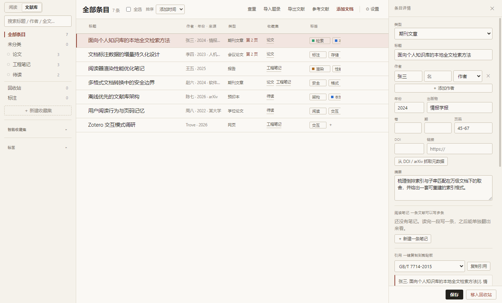
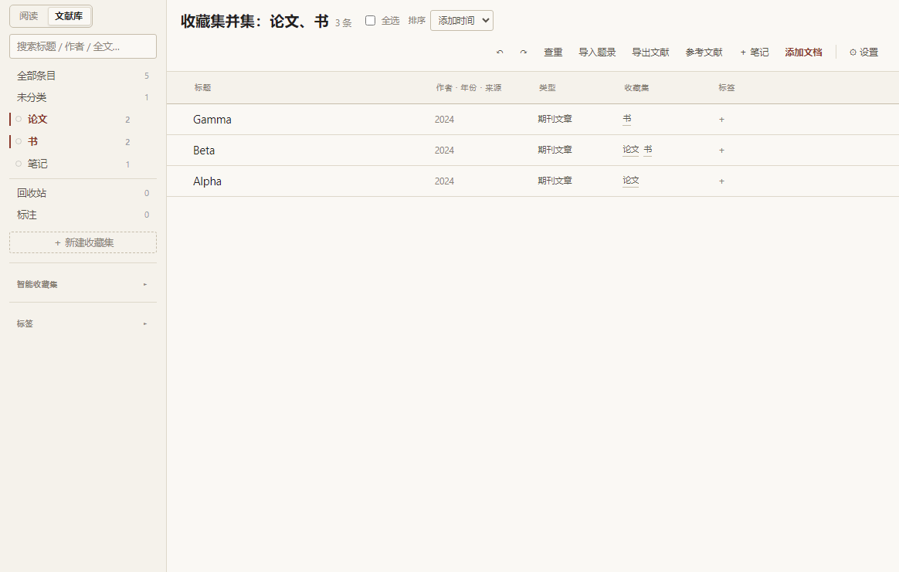
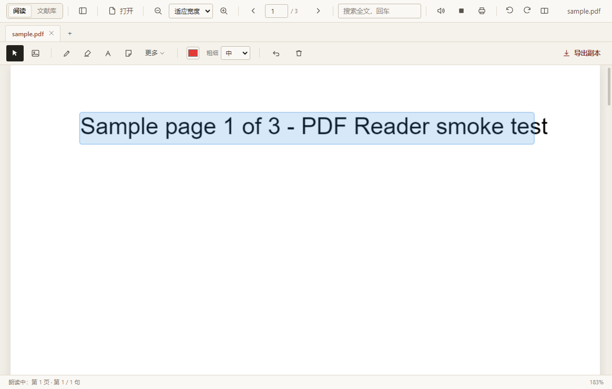

# Trove

**本地优先的文献管理与阅读器。** 把题录、PDF、阅读进度、标注、笔记和引用放在同一个库里，数据存在自己机器上，不用账号、不强制联网。

适合谁：**需要长期读文献并留下痕迹的人**（研究生、教师、工程师、做综述的人）。如果你只是偶尔翻两篇 PDF，它偏重。

一句话说清边界：**它是一个「库 + 阅读器」，不是云同步服务**。没有群组库、浏览器插件和 Word 自动引注；联网只发生在你主动要求的时刻（抓元数据、下 PDF、刷订阅）。



**当前版本 1.5.0**（2026-10-29）。更新记录见 [CHANGELOG.md](CHANGELOG.md)。

## 目录

| 想找什么 | 去哪一节 |
| --- | --- |
| 跑起来要几步 | [开始使用](#开始使用) |
| 怎么管文献 | [文献库](#文献库) |
| 怎么读、怎么标 | [阅读与标注](#阅读与标注) |
| 能打开哪些文件 | [支持格式](#支持格式) |
| 笔记 / 综述 / 引用 | [笔记与写作](#笔记与内容复用)、[搜索与引用](#搜索与引用) |
| 文件存在哪、怎么备份 | [数据、备份与迁移](#数据备份与迁移) |
| 手要记哪些键 | [常用快捷键](#常用快捷键) |
| 现在还做不到什么 | [当前边界](#当前边界) |
| 源码结构与开发文档 | [开发与文档](#开发与文档) |

## 开始使用

已有安装包可直接运行便携版或使用安装版。构建文件位于 `build/`，不随源码提交；请核对其构建时间和对应提交。

从源码运行需要 Node.js 18+、npm 和 Windows：

```powershell
npm ci --no-audit --no-fund
npm run copy-pdfjs
Remove-Item Env:\ELECTRON_RUN_AS_NODE -ErrorAction SilentlyContinue
npm start
```

首次克隆必须执行 `copy-pdfjs`，生成的 PDF.js 文件不受 Git 跟踪。安装与打包排错见[开发文档](docs/development.md)。

平台：面向 Windows 10/11 构建与验证；macOS / Linux 未做打包验收（代码没有硬依赖 Windows API，但不承诺开箱可用）。

## 文献库

- 管理 37 类题录，编辑结构化作者、年份、DOI、URL、摘要及类型专属字段。
- 用标签、嵌套收藏集、智能收藏集整理条目，支持多选、批量编辑、回收站、查重合并和相关条目。工具栏「统计」可查看类型 / 年份 / 标签分布、附件与笔记覆盖率（本地现算，回收站条目不计入），以及阅读时长（打开文档且窗口可见时每 15 秒记一次，12 周热力图；数据在本机，可整文件删除）。
- 收藏集支持 `Ctrl` / `Cmd` + 点击多选，按并集显示条目（同一篇在多个集合里只出现一次）；普通点击仍只选一个，取消最后一个回到「全部条目」。
- 导入与导出 BibTeX、RIS、CSL-JSON、EndNote 标签式 `.enw`、EndNote XML（含 UTF-16 导出）、RefWorks tagged。
- 导入本地 PDF 时自动读首页找 DOI / arXiv，并走 Crossref / arXiv 补全题录（标题、作者、年份、期刊、卷期页、摘要、标签、文献类型）。显式填过的字段不会被覆盖；找不到标识就保留文件名与 PDF 自带元数据，不阻塞导入。详情面板「从文件补全题录」可对已有条目只补空字段。
- 附件记录文件指纹（大小 + 首尾 64 KB 的 SHA-1）。文件被改名或移动后，打开条目会在原目录自动找回；详情面板「扫描文件夹找回…」可按指纹批量认回（只处理有指纹的条目）。
- 阅读队列：详情面板可把条目标为待读 / 在读 / 已读，侧栏「阅读队列」列出待读与在读（在读优先，其余按入库时间）；打开待读条目会自动转为在读，批量栏可一次标记。
- 回顾：工具栏「回顾」把标注按间隔重复推回来复习。一次最多 30 张，摘录默认模糊（先自己在心里回想），空格显示答案后用 `1` 忘了 / `2` 模糊 / `3` 记得 / `4` 太简单决定下次什么时候再见；面板显示本次进度、今日已完成与待复习数，走完给出计数与下次到期时间。卡片键就是标注 id，改文字、改颜色、加标签都不影响复习记录；「移出回顾」只停复习，不动标注本身。空态可一键把现有标注都纳入，标注视图选中几条后也能只加选中的。
- 按 DOI/arXiv 抓取元数据，为条目单独或批量下载可获取的 PDF。下载后进入索引队列；批量任务可取消，当前条目处理完成后生效。
- RSS 订阅：工具栏「订阅」可添加期刊 / arXiv 的 RSS / Atom 源，按需拉取新文章并把感兴趣的收进文献库（webpage 条目）；订阅跟随文献库备份。
- 保存网页为本地 MHTML 和首屏 PNG；MHTML 通过外部程序打开。
- 按条目信息重命名附件，标注和索引跟随应用内改名；文件在外部移动后可重新定位附件。
- 库级写操作支持最多 20 步撤销/重做，连续笔记编辑不占用这套操作栈。删除条目、收藏集或清空回收站不会删除原始文档。

多个收藏集并集（`Ctrl` / `Cmd` + 点击收藏集，右侧按并集去重显示）：



大库列表按视口挂载行，选择状态按条目 key 保存。检索与数据读写仍使用本地 JSON。

## 阅读与标注

PDF 使用 PDF.js，保留文本层；其它格式转换为可阅读的 HTML。支持连续滚动、单页翻页、双页对开（`Ctrl+Shift+D`，偶数页在左、奇数页在右，封面独占）、目录、缩略图、文内搜索、缩放、深色页面反色与专注阅读。


- 多标签阅读，各文档记住页码、视图旋转角与参考页；读过的 PDF 在文献列表显示进度条，详情面板可「继续阅读」直接回到上次位置。设置中开启会话恢复后，下次启动恢复最多 20 个标签及激活项；失联文件跳过并提示。
- 整篇文档可旋转 90° / 180° / 270°（工具栏按钮或 `Ctrl+[` / `Ctrl+]`）。旋转只改显示：原文件、打印和带标注副本仍按原方向输出；标注、选区与搜索高亮继续按未旋转页面坐标保存。
- 分屏参考视图在右侧独立显示同一 PDF 的另一页，只读、不带标注，可单独翻页或勾选「跟随」对照正文下一页。参考页随视图旋转，并随标签 / 会话恢复。点参考栏的 `⇄` 可以选另一篇文献做跨文档对照（比如正文对补充材料）；对照路径按标签保存、随会话恢复，跨文档时「跟随」自动关闭。
- 导航历史记录目录、搜索、批注和显式跳页，可后退/前进；历史按标签隔离，最多 60 个位置。按 `B` 给当前页加 / 删书签，书签列在侧栏「目录」页顶部，点击跳页。
- **智能跳转**：PDF 里点引用标记（`[12]` / `[Smith, 2020]`，不需要文档自带链接）跳到参考文献条目并高亮；点参考文献条目行反查正文引用标记。只识别常见的数字型与作者-年份型，识别错误时不会跳转。
- **引用跟随（Portal）**：读到 `[12]` 时除了跳本文参考文献表，还能把**那条文献本身**在右侧对照栏打开到起始页（前提是它在库里）。判定只认 DOI 相同，或标题词 + 年份 + 姓氏都对得上；拿不准就不跳，不会随便打开一篇。命令面板可开关，默认开。
- **阅读标尺**：`Ctrl+Shift+L` 打开一条跟着鼠标走的横向色带，把当前行从上下文中「顶出来」；`Alt+↑/↓` 调高度。只画不拦事件，不影响选区与标注。
- **重排阅读**：工具栏「重排」图标（或 `Ctrl+Shift+R`）把一页文字按坐标还原成段落（去断词连字符、按栏切分），用可调字号与栏宽连续显示，目录里双击条目可跳页。图表、公式与跨栏大图留在原位不重排。
- **命令面板**：`Ctrl+K` 或 `Ctrl+Shift+P` 模糊搜全部命令，分组显示快捷键，`↑↓` 选、`Enter` 执行。不用记按钮在哪。
- 画笔、荧光笔、直线、矩形、箭头、文字、便签、文字高亮、下划线、摘录、**印章**与图片标注。印章有 5 个预设（已阅 / 存疑 / ★ / ✓ / 待办，颜色各自固定），按 `S` 切过去点一下就落章，不用拖。
- PDF 自带标准批注可导入本地标注层，保留支持类型的文字、评论、作者与颜色，按原生 ID 去重；回复关系（/IRT）记录为「↳ 回复」标记显示在批注面板与标注库；标注视图里回复嵌在父批注下面（左缩进 + 竖线，最多画 3 层），父批注被筛掉时回复退为顶层显示，不会消失。扫描时切换文档会取消导入。
- 文献库“标注”视图汇总各文档批注，支持文字搜索、标签、类型与颜色筛选，以及生成带截图笔记。
- 支持查看 PDF 内嵌位图、调用系统默认程序打印。扫描件没有文字层，朗读会跳过该页；整篇都是扫描页时提示没有可读正文。
- 朗读按句连续进行：读完当前页自动接下一页，空白页跳过；当前句在页面上高亮并自动滚动到可见位置。支持暂停 / 继续，并按文档记住上次读到的页码与句序，下次打开同一文件从该句续读；朗读中按 `H` / `U` 可直接给当前句加高亮 / 下划线。
- 可导出批注 MD/CSV/TXT 或带标注的 PDF 副本；带标注副本只支持 PDF。中文等非拉丁文字标注会用系统 CJK 字体做**子集嵌入**（只带用到的字形，体积只多几 KB）；系统里找不到可用字体时退回 Helvetica 并跳过中文，界面显示跳过数量。
- 工具栏的「批注归档」按钮（命令面板里叫「导出批注归档」）出一个 zip：原文档 + `annotations.json`（可回读）+ `标注.md`（按页排的清单）+ `README.txt`。要交给别人继续改，用这个；只想看就用带标注的 PDF。导出前保存当前批注；读取或写入失败会中止导出并提示原因。

页面旋转 90° 后配合分屏参考视图（右侧为同一 PDF 的第 2 页）：


朗读时的句级高亮与跨页进度：



### 支持格式

| 类别 | 格式与主要边界 |
| --- | --- |
| PDF | PDF.js 渲染、文字层、搜索、标注与副本导出 |
| Word | `.docx`、`.doc`、`.rtf`、`.odt`；旧 `.doc` 主要提取文字 |
| 演示文稿 | `.pptx`、`.odp`；旧 `.ppt` 需先转换 |
| 表格 | `.xlsx`、`.xls`、`.ods`、`.csv`；每表最多 2000 行 × 80 列 |
| 网页与 Markdown | `.html`、`.htm`、`.md`、`.markdown` |
| 电子书 | `.epub`，按章节阅读 |
| 图片 | PNG、JPG、GIF、WebP、BMP、SVG、AVIF 等 |
| 文本与代码 | TXT、JSON、XML、JS、TS、Python 等 |

富文档保留常见文字、列表、表格与图片，不还原复杂分栏、文本框定位、动画或图表。转换最多 400 页、总 HTML 12 MB、单张图片 8 MB，超限可能截断。

## 笔记与内容复用

文献可挂多条子笔记，也可创建独立笔记。独立笔记使用全屏 Markdown 源码/预览编辑器，子笔记在详情面板编辑富文本。独立笔记正文可写 `[[笔记标题]]` 互链，预览末尾会列出提到本条的反向链接。笔记改名后旧标题会作为别名保留，`[[旧标题]]` 仍能跳转（现标题优先；旧标题被新笔记占用时以现标题为准，反链也只统计真正指向本条的链接）。

- 内置课程笔记、论文卡片、摘录汇总模板；已有正文时追加到末尾，保留原选区内容。
- 综述草稿：工具栏「综述草稿」把批注按标签（主题）/ 按文献 / 不分组汇总成 Markdown，每条带文内引注与页码，末尾附参考文献表；范围可选当前列表 / 已选条目 / 整库，可只保留评论。多标签批注按第一个标签归类，编号制样式的编号与参考文献表一一对应。
- 两类笔记均可导出 HTML、Markdown 或 Word（`.doc`）。Word 是带 mso 页面设置的 HTML，Word / WPS 双击即可打开，标题层级、表格边框、引用块按论文笔记的常见排版给；导出先确认保存成功，失败时保留编辑内容并取消导出。
- 笔记里的表格在三种导出里都保留为真表格（含表头；单元格里的 `|` 自动转义）。表格也能可视化编辑：光标停在已有表格里点「表格」，就打开一张格子界面，`＋行 / −行 / ＋列 / −列` 改结构、方向键在格子间移动，确认后按原位置替换 Markdown；光标不在表格里则从 3×3 起插到光标处。删到 1×1 也不会写出坏表。
- 正文图片与批注截图复制到导出文件旁的 `.files/` 目录，改写为相对引用。**分享或移动时要连同图片目录一起携带**，HTML 并未把这些图片嵌入单个文件。
- HTML 对缺失的本地图片显示占位说明；Markdown 保留缺失引用，界面提示缺失数量。
- 支持旧 Markdown 子笔记和富文本笔记的来源链接转换；导出链接保留查询参数，非法协议不会变成可点链接。

自定义引用卡、提示框、任务列表等语法用于笔记预览；数学公式 `$…$` / `$$…$$` 由本地 KaTeX 渲染（需先执行 `npm run copy-pdfjs`，资源缺失时按源码显示）。导出 HTML 携带公式排版与字体；富文本子笔记内公式仍按源码显示。

## 搜索与引用

库级搜索合并正文、批注、摘录和笔记，显示来源、页码与片段，可按结果类型切换。首屏显示 20 条，展开后按页获取更多；主进程默认每页 120 条。

统一语法支持短语、排除、字段限定、AND、OR/`|` 与括号，例如：

```text
"machine learning" -survey
author:Smith year:2024
title:阅读 OR tag:课程
```

搜索框旁的「条件」按钮提供可视化构建器：选字段、勾排除、多条件 AND；打开时会把当前查询反向解析回填（OR / 括号等复杂语法请在搜索框直接输入）。

「🎯 条件检索」是另一条路，对应 Zotero 的高级检索：一行一个条件（字段 + 运算符 + 值），匹配可选「全部条件（且）」或「任一条件（或）」，底部实时显示命中数。

- 运算符按字段类型给：文本有包含 / 不包含 / 是 / 不是 / 开头是 / 结尾是，数值有等于 / 大于 / 小于 / 不小于 / 不大于，枚举与「有 / 没有」，外加通用的「为空 / 不为空」——后者不需要填值，用来找缺 DOI、缺年份、没附件的条目。
- 条件可以**分组嵌套**（最上面的匹配作用于顶层条件之间）：`＋ 条件组` 加一个组，组内单独选「且 / 或」，组里还能再嵌组（最多 4 层），`×` 删组会连同组内条件一起删。比如「(2016 年后 **且** 有附件) **或** (学年份为空 **且** 有红色批注)」。空组不影响结果，也不计入描述里的组数。
- 可以按批注属性筛：标注数、有标注、标注类型、标注颜色、标注带批注、标注文字或批注。比如「标注数大于 5」「有红色批注」「标注带我自己写的评论」。
- 点「检索」立刻生效，列表顶部出现横幅写明当前条件与条数，「清除」一键退出；「存为智能收藏集」把条件存进左侧（存的是条件树，不是拍平的串），之后点它就能复用，横幅上的「查看条件」可以接着改。
- 条件检索作用于条目列表；标注视图有自己的一套类型 / 颜色筛选。

条目详情里有「相似文献」：按全文索引算 tf-idf 余弦，列出内容相近的其它条目并给出相似度与共享词（说明「为什么像」），点一行直接打开对方。纯本地计算，不联网、不下载模型。

从论文的参考文献表**批量入库**：工具栏「参考文献表入库」图标（命令面板里叫「参考文献表批量入库」）会从文末的 References 段切条、抽字段，先出一张预览（带 DOI / 标题已解析 / 只能猜 三档置信度，并标出库里已有的重复项），勾选后再导入；带 DOI 的条目可以联网补全题录。默认只勾「新增且能解析」的那些，认错的取消勾选即可。

全文搜索是子串匹配与相关性评分，不做分词、OCR 或语义检索。首次导入后需等待索引完成（导入后会立刻排队补建，建好即可搜到），也可在设置中重建。

引用提供 5 种内置格式与 3 种内置 CSL 样式，可导入/删除自定义 `.csl`。参考文献表支持 Markdown、文本、HTML、Word `.doc` 和 RTF；`.doc` 是带格式的 HTML。CSL 是自研子集，导入成功不代表符合完整 CSL 或期刊逐字排版要求。详情面板「文内引注…」可生成带页码定位符的正文引注（编号制 `[n, p. 5]` / 作者-年份制 `(Smith, 2024, p. 5)`）。

引用键（`[@key]`）按模板生成，可在设置里改：`[字段:修饰符:修饰符]` 加字面量，例如 `[auth:lower][year][veryshorttitle:lower]`。字段有 `auth` / `authEtAl` / `authIni` / `authN` / `authors` / `year` / `shortyear` / `title` / `shorttitle` / `veryshorttitle` / `journal` / `journalabbr` / `volume` / `pages` / `firstpage` / `doi` / `itemtype` / `key`，修饰符有 `:lower` `:upper` `:capitalize` `:abbr` 与 `:数字`（截断）。默认模板与旧版规则完全一致，已经贴进文稿的键不会变；重名自动加 `-2` 后缀，键长上限 40 字符。

## 数据、备份与迁移

默认 `userData` 和数据目录为 `%APPDATA%\trove`。数据目录可在设置中更换；部分应用状态仍固定保存在 userData。

| 数据 | 位置 |
| --- | --- |
| 文献库 | `<数据目录>/library.json`，数据层版本 v8 |
| 标注 | `<userData>/annotations/<路径哈希>.json` |
| 图片、网页快照 | `<数据目录>/snapshots/` |
| 托管 PDF、CSL | `<数据目录>/attachments/`、`styles/` |
| 全文索引、备份 | `<数据目录>/fulltext/`、`backups/` |
| 回顾（复习进度） | `<userData>/recall.json` |
| 设置、窗口、会话 | `<userData>/settings.json`、`window-state.json`、`session.json` |

智能收藏集（保存的检索）存在 `library.json` 的 `searches` 里：老的串式检索只有 `query`，条件式检索多 `match` 与 `conditions`（此时 `query` 为空），两种可以共存。

JSON 备份包含库、标注、回顾进度、设置和受管图片/快照/CSL/附件；**不含外部引用的原始文档与全文索引**。托管资源总量上限为 60 MB，超限报错。完整归档应同时保留原始文档、数据目录及 userData。

存储位置支持移动、合并、切换已有库。移动复制后保留旧目录；合并时同 key 保留目标条目。资源冲突避让并改写引用，写入失败尝试回滚，成功后才切换目录。恢复前自动生成快照。具体数据约定见[架构文档](docs/architecture.md)。

## 常用快捷键

| 操作 | 快捷键 |
| --- | --- |
| 打开 / 文内搜索 | `Ctrl+O` / `Ctrl+F` |
| 缩放 / 适应宽度 | `Ctrl+滚轮` / `Ctrl+0` |
| 放大模式 | `Z`，滚轮缩放；空格 + 左键拖动平移；`Z` 或 `Esc` 退出 |
| 翻页 | 方向键、PgUp/PgDn、空格 |
| 命令面板 | `Ctrl+K` 或 `Ctrl+Shift+P` |
| 阅读标尺开关 / 调高度 | `Ctrl+Shift+L` / `Alt+↑`、`Alt+↓` |
| 重排阅读 | `Ctrl+Shift+R` |
| 切工具（选择 / 画笔 / 荧光笔 / 文字 / 便签 / 印章） | `Esc` / `P` / `H` / `T` / `N` / `S` |
| 阅读历史 | `Alt+←` / `Alt+→`，或鼠标侧键 |
| 搜索上一项 / 下一项 | `Shift+F3` / `F3` |
| 朗读中标注当前句 | `H` 高亮 / `U` 下划线 |
| 旋转页面（逆 / 顺） | `Ctrl+[` / `Ctrl+]` |
| 双页对开 | `Ctrl+Shift+D` |
| 当前页加 / 删书签 | `B` |
| 专注模式 / 打印 | `F11` / `Ctrl+P` |
| PDF 副本导出 | `Ctrl+S` |
| 库操作撤销 / 重做 | `Ctrl+Z` / `Ctrl+Y` 或 `Ctrl+Shift+Z` |
| 回顾面板：显示答案 / 评分 / 关闭 | `空格` / `1`–`4` / `Esc` |
| 独立笔记保存 / 返回 | 编辑器内 `Ctrl+S` / `Esc` |

工具栏、页面右键菜单、文献库设置提供其它入口。编辑器聚焦时部分快捷键用于文字编辑。

## 当前边界

- 中文、日文等文字标注靠系统 CJK 字体做子集嵌入导出。系统里（Windows 黑体 / 雅黑；macOS / Linux 的常见路径）找不到可用 `.ttf` 时仍退回 Helvetica、跳过中文并计数，需核对副本；`.ttc` 字体集合与 CFF 的 `.otf` 不支持（pdf-lib 的嵌入器吃不了）。
- 导入时的题录识别只读 PDF 前两页文本，且依赖 Crossref / arXiv 联网；扫描件、加密 PDF、首页没有 DOI 的文档会跳过识别，仍按文件名与内嵌元数据入库。识别结果只补空字段，不覆盖已填内容。
- 附件指纹找回只对记录了指纹的条目生效（旧库条目会在首次成功打开时补记）；指纹是「大小 + 首尾 64 KB 哈希」，理论上存在同大小同首尾的不同文件被误认的可能。没有指纹时只在原目录按同名兜底。
- 页面旋转与分屏只对 PDF 生效，且是视图能力：打印、带标注副本导出仍按原文件方向，页面 PNG 导出按当前旋转方向；分屏为只读位图，不参与标注与文本选择。跨文档对照的对方文档同样不参与标注、搜索与引用跳转。
- 回顾的调度是 SM-2 骨架而不是 FSRS：间隔只由「这张卡的间隔 + 当前 EF + 这次的评分」决定，不考虑整库的复习历史；「忘了」的卡片 10 分钟后才再次到期，当次会话不会重复出现。复习进度不进文献库（在 `<userData>/recall.json`），换数据目录不会跟着走，但会随 JSON 备份一起迁移。
- 朗读依赖系统语音；句级高亮与句序记忆只对 PDF 生效，富文档（Word / PPT / Markdown 等）可以跨页连续朗读但没有句级高亮。位置记忆存在本机 `localStorage`，不写入文献库。
- 原生 PDF 批注导入只处理支持的标准对象；扁平化批注无法恢复，部分形状跳过。回复关系会重排成嵌套树，但只有一层缩进画得最清楚（更深层级靠 `data-depth` 逐级缩进），且父批注被删而回复还在时，回复会以顶层出现。
- 无云同步、群组库、浏览器连接器或 Word 自动引注插件；订阅只在点「添加 / 看条目 / 刷新」时联网，不后台轮询、不推送。
- 复杂富文本经 HTML/Markdown 转换可能简化，不能承诺所有粘贴排版无损往返。表格在三种导出里都会保留，但单元格内的合并、嵌套表格会被摊平。
- 笔记的表格可视化编辑只处理 Markdown 管道表格：合并单元格、嵌套表格、单元格里跨行的内容都会被摊平；富文本子笔记的表格仍走富文本编辑器。
- 重排阅读是「按坐标重排文本」，不是排版引擎：图表、公式、跨栏大图留在原位不重排；扫描件没有文字层就没有可重排内容；双栏切分靠字号与间距启发式，拦不住所有版式。
- 相似文献用词袋（拉丁词 + 中文二元组）算余弦，抓不到同义改写；库里没有全文索引的条目（没有文本层、未建索引）不参与。
- 引用跟随（Portal）只认 DOI 相同，或标题词 + 年份 + 姓氏都对得上；参考文献是自由文本、多数没有 DOI，所以「不跳」比「跳错」常见。它只在对照栏打开，不影响本文位置。
- 参考文献表批量入库是启发式解析：标题靠引号 / APA 括号年份 / 句点与逗号切片猜，条目没有编号、没有换行、整段挤成一行时切条会出错。所以先出预览、带置信度、默认只勾能解析的，认错要手动取消；单次最多 400 条、联网补全最多 60 条。
- 条件检索没有正则、日期区间与「同名作者」这类语义条件；条件组最多嵌套 4 层，超过的组会被丢掉（不报错）。
- 印章是本地标注层里的一个图章（导出时画文字框），不是 PDF 的标准 Stamp 注释；旋转页面上落章的框按旋转后的坐标算，导出方向仍按原文件。
- Word 导出里的公式是 KaTeX 展开后的 HTML，Word 不会加载相对路径的样式表，位置不保证精确；带图导出时要把 `.files/` 目录一起带走。
- 引用键模板对中文作者没有拼音转写（没有拼音库），会退到 `item`+条目 key 前缀的兜底键；键长上限沿用旧的 40 字符，模板再长也会被截断。
- 全文检索与索引跑在独立的 worker 线程里（查询不再占主进程，大库输入不会跟着变钝）；索引按变更增量补建，导入 / 抓取 / 重新定位后自动排队，建完会广播给界面。检索仍是「每份文档一个 JSON」的子串匹配 + 相关性评分，没有倒排索引与分词；索引仍在数据目录 `fulltext/` 下，删掉可重建。
- 原始文档在资源管理器中改名后，标注不会自动跟随路径，需重新定位。
- 当前以 Windows 验证为主，macOS/Linux 未完成打包验收。

## 开发与文档

源码托管在本仓库，Electron + PDF.js，MIT 许可。要改代码就从这里进：

| 想知道 | 看哪份 |
| --- | --- |
| 不确定看哪份 | [docs/README.md](docs/README.md)（文档索引） |
| 进程、模块与数据约定 | [docs/architecture.md](docs/architecture.md) |
| 跑测试、打包、日常维护 | [docs/development.md](docs/development.md) |
| 版本变化 | [CHANGELOG.md](CHANGELOG.md) |
| 功能差距与规划依据 | [docs/竞品调研-2026-10-26.md](docs/竞品调研-2026-10-26.md) |


## 许可

MIT，见 [LICENSE](LICENSE)。
